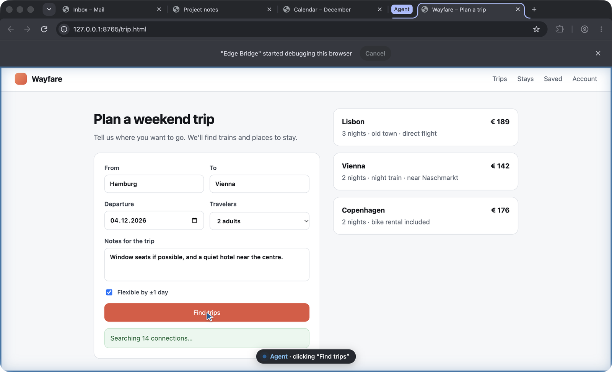
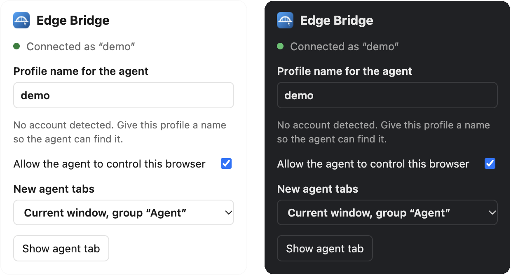
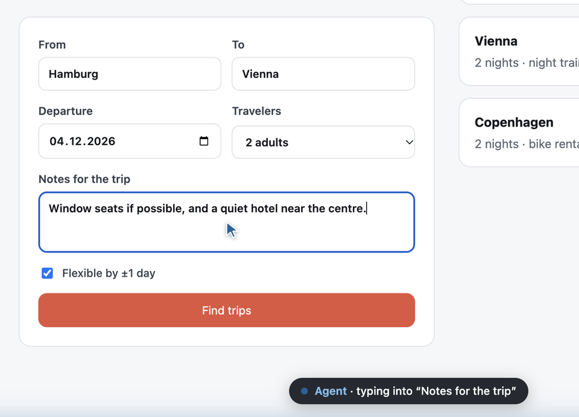

<p align="center">
  
</p>

<h1 align="center">Edge Bridge</h1>

<p align="center">
  Let Claude Code and other MCP agents use <b>your real Microsoft Edge</b> – with your logins, in the profile you choose,<br>
  and with every click visible on screen.
</p>

<p align="center">
  
</p>

## Why Edge Bridge

Browser agents usually get a fresh, empty browser: no logins, no cookies, no extensions, and a separate
window you never look at. Edge Bridge turns that around.

- **Your browser, your sessions.** The agent works in the Edge you already use, so it is signed in
  wherever you are. No credentials are passed to the agent.
- **Profile-aware.** Each Edge profile (personal, work, a client) connects separately. Tell the agent
  "in my work profile …" and it acts there and nowhere else.
- **You see what it does.** New agent tabs open in a blue tab group called **Agent**. On the page, a
  frame, an animated cursor and a status line ("clicking “Find trips”", "typing into “Notes”") show
  every step. The agent's own screenshots stay clean.
- **Reads pages like a screen reader.** `snapshot` returns a compact accessibility tree with refs
  (`[ref=e7]`) instead of a screenshot, which is fast and uses few tokens.
- **Real input.** Clicks and keystrokes go through the Chrome DevTools Protocol as real mouse and keyboard
  events, so React apps, rich text editors, shadow DOM, same-origin iframes and hidden file inputs work.
- **Local only.** A small daemon on `127.0.0.1`, protected by a token. No cloud service, no telemetry,
  no account.
- **Small and hackable.** About 1,800 lines of plain JavaScript and TypeScript, no build step.

## How it works

```
Claude Code ──stdio──▶ src/mcp.ts ──HTTP + token──▶ src/daemon.ts ◀──WebSocket── extension (one per Edge profile)
edge-bridge CLI ─────────────────────HTTP + token──▶ 127.0.0.1:10087              chrome.debugger + chrome.scripting
```

- `extension/` – Manifest V3 extension. It keeps a WebSocket to the daemon and runs commands with
  `chrome.debugger` (input events, screenshots) and `chrome.scripting` (page snapshot, element lookup).
- `src/daemon.ts` – holds the connections of all profiles and routes each command to the right one.
- `src/mcp.ts` – MCP server over stdio. `src/cli.ts` – the same actions from the shell.
- `skill/SKILL.md` – an agent skill that teaches the agent the workflow and the safety rules.

The daemon starts on demand with the first MCP or CLI call. On macOS you can also run it as a login item.

## Setup

You need Node.js 22.18 or newer (it runs the TypeScript sources directly) and Microsoft Edge. Google
Chrome works as well; other Chromium browsers should, but are untested.

**1. Get the code**

```sh
git clone https://github.com/jonasrht/edge-bridge.git
cd edge-bridge
npm install
```

**2. Load the extension, in every profile you want the agent to use**

Open `edge://extensions`, turn on **Developer mode**, click **Load unpacked** and pick the `extension/`
folder. Then open the extension's popup and give the profile a short name such as `personal` or `work`.
If you are signed in to the profile, its Edge profile name works as well.

<p align="center">
  
</p>

**3. Connect your agent**

Claude Code:

```sh
claude mcp add -s user edge-bridge -- node /path/to/edge-bridge/src/mcp.ts
```

Any other MCP client:

```json
{
  "mcpServers": {
    "edge-bridge": { "command": "node", "args": ["/path/to/edge-bridge/src/mcp.ts"] }
  }
}
```

**4. Add the skill (recommended)**

The skill tells the agent how to work with the browser: which profile to use, snapshot before clicking,
never type passwords, ask before submitting or buying. For Claude Code:

```sh
mkdir -p ~/.claude/skills
ln -s "$PWD/skill" ~/.claude/skills/edge-bridge
```

**5. Optional extras**

```sh
ln -s "$PWD/scripts/edge-bridge" ~/.local/bin/edge-bridge   # CLI on your PATH
scripts/install-service.sh                                  # macOS: keep the daemon running at login
```

Check that everything is connected:

```sh
edge-bridge status
```

## Using it

Just ask your agent, for example:

> In my work profile, open our Jira board and list the tickets assigned to me that are due this week.

> Fill in the travel form on wayfare.example with Hamburg → Vienna, two adults, and show it to me before submitting.

This is what the agent sees when it calls `snapshot`:

```
URL: https://wayfare.example/trip
Title: Wayfare – Plan a trip
- main:
  - heading "Plan a weekend trip" [level=1]
  - form:
    - textbox "From" [ref=e1]
    - textbox "To" [ref=e2]
    - textbox "Departure" [ref=e3] value="2026-12-04" type=date
    - combobox "Travelers" [ref=e4] selected="1 adult"
    - textbox "Notes for the trip" [ref=e5]
    - checkbox "Flexible by ±1 day" [ref=e6] [checked]
    - button "Find trips" [ref=e7]
```

…and what you see while it types:

<p align="center">
  
</p>

### Tools

| Tool | What it does |
| --- | --- |
| `list_profiles` | Profiles that are connected right now |
| `list_tabs` | Open tabs of a profile; tabs the agent opened are marked `agent: true` |
| `navigate` | Open a URL in the agent's tab, or in a new agent tab |
| `select_tab`, `close_tab`, `history` | Switch to a tab, close it, go back, forward or reload |
| `snapshot` | Accessibility tree with refs for the other tools |
| `get_text` | Visible text of the page, for long articles |
| `click`, `hover` | By ref, CSS selector or x/y coordinates |
| `type`, `press_key` | Type text, optionally clear first and submit; key combos like `Meta+a` |
| `select_option`, `upload_file` | Native `<select>` options; files into (even hidden) file inputs |
| `scroll`, `wait_for` | Scroll the page or a container; wait for text or a selector |
| `screenshot` | Viewport, full page or a single element |
| `evaluate` | Run JavaScript in the page |

Every tool takes an optional `profile`. The CLI exposes the same actions:

```sh
edge-bridge navigate '{"url":"example.com"}' -p work
edge-bridge snapshot -p work
edge-bridge click '{"ref":"e7"}' -p work
```

## Security

The extension has full control over the browser, so the bridge to it is locked down:

- The daemon only listens on `127.0.0.1`. HTTP requests need the token from `~/.edge-bridge/token`
  (created with mode `0600`).
- Requests that carry an `Origin` header or an unexpected `Host` are rejected, so websites cannot reach
  the daemon, not even through DNS rebinding.
- The WebSocket only accepts the extension's fixed ID (`kfjjmfgccekckgnegnjdbbloopmjdidk`, set through
  the `key` in the manifest).
- Each profile can be switched off in the popup, and profiles without the extension are never touched.
- The skill tells the agent never to enter passwords, 2FA codes or payment details, to confirm before
  anything irreversible, and to treat page content as data rather than instructions.

## Good to know

- While the agent controls a tab, Edge shows the bar *"Edge Bridge" started debugging this browser*. The
  debugger detaches after two minutes without commands.
- Only one debugger can attach to a tab. DevTools or another automation extension in the same tab will
  block the agent.
- `edge://` pages and the extension stores are off-limits for every extension.
- Content inside cross-origin iframes can't be read; the agent can still click it by screenshot
  coordinates.
- Developed and tested on macOS. The daemon and extension are cross-platform, `install-service.sh` is
  macOS only.

## Development

```sh
npm run check                            # type-check
edge-bridge reload_extension -p work     # reload the extension after changes in extension/
CHROME=/path/to/chrome scripts/render-icons.sh   # rebuild icons from docs/logo.svg
```

The extension's UI is available in English and German (`extension/_locales`). If you change the `key` in
the manifest, set `EDGE_BRIDGE_EXTENSION_IDS` for the daemon to the new extension ID.
